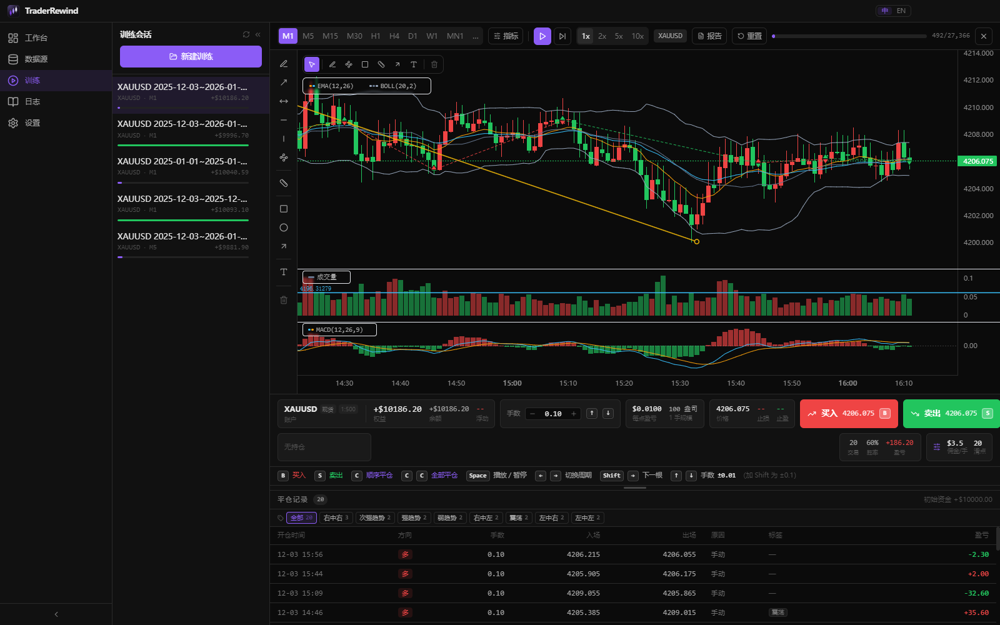
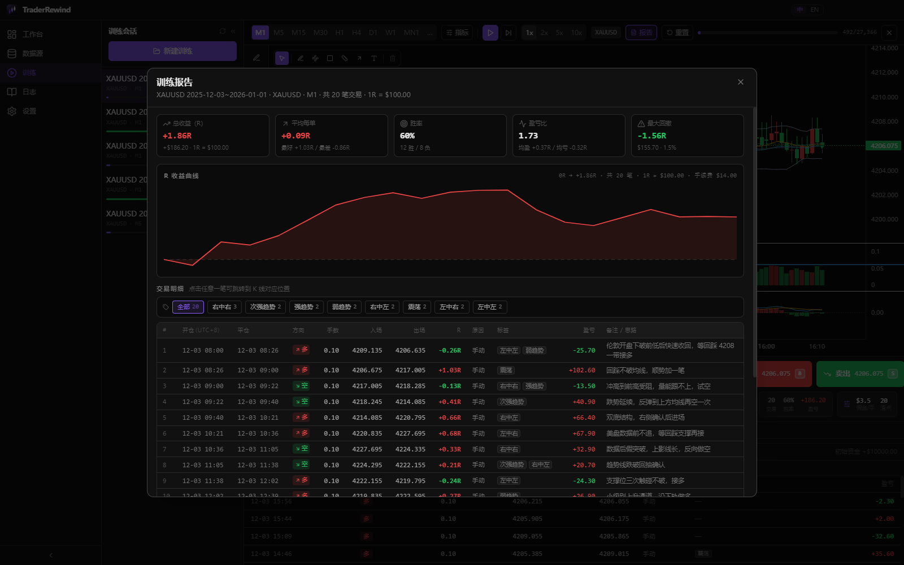
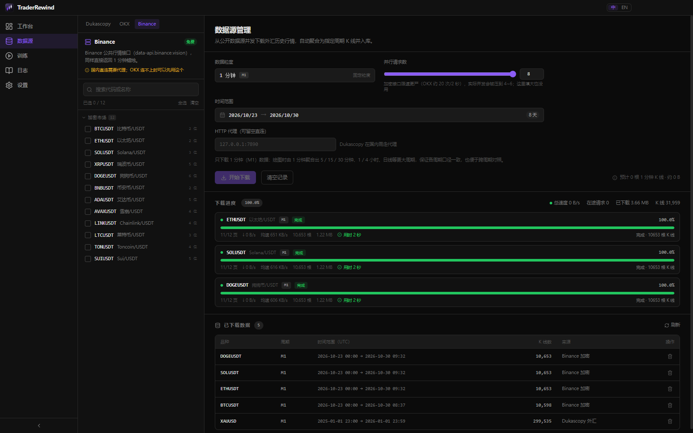
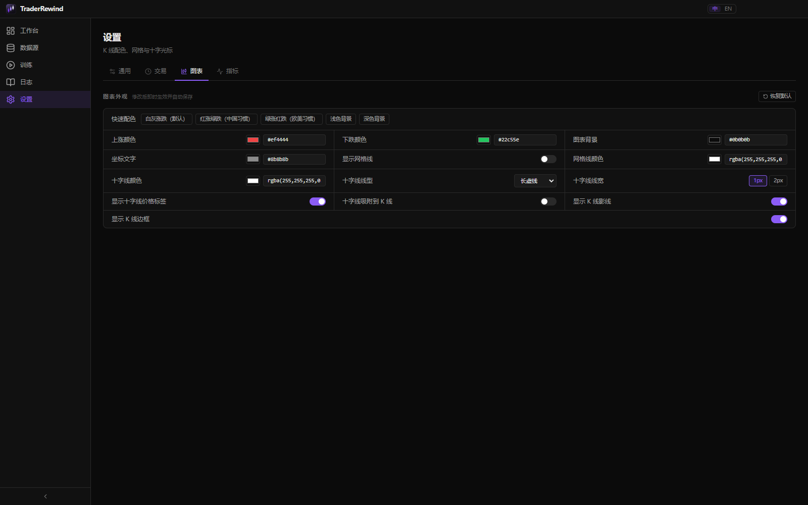
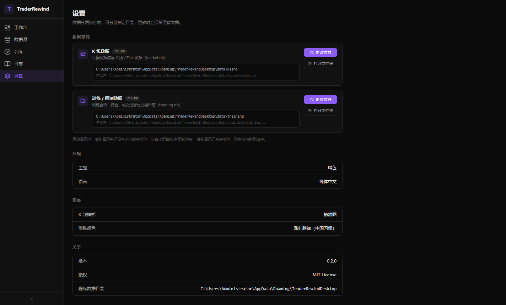

[简体中文](README.md) | **English**

# TraderRewind

A market replay and trading-practice tool — watch old price action like a recording, and rehearse on it.

Runs entirely offline. No account, no connection to any broker. All data stays on your own disk.

[](LICENSE)
[](#build-and-run)
[](https://www.electronjs.org/)
[](CONTRIBUTING.md)



## Contents

- [Download and install](#download-and-install)
- [The problem it solves](#the-problem-it-solves)
- [Screenshots](#screenshots)
- [Features in detail](#features-in-detail)
  - [1. Replay training](#1-replay-training)
  - [2. Chart and drawing tools](#2-chart-and-drawing-tools)
  - [3. Technical indicators](#3-technical-indicators)
  - [4. Simulated orders and risk](#4-simulated-orders-and-risk)
  - [5. Training report and review](#5-training-report-and-review)
  - [6. Data sources and downloads](#6-data-sources-and-downloads)
  - [7. Data storage](#7-data-storage)
  - [8. Settings](#8-settings)
- [Keyboard shortcuts](#keyboard-shortcuts)
- [Tech stack](#tech-stack)
- [Project layout](#project-layout)
- [Where the data comes from](#where-the-data-comes-from)
- [Build and run](#build-and-run)
- [Contributing](#contributing)
- [License](#license)

## Download and install

Grab the file you need from [GitHub Releases](https://github.com/liudosen/TraderRewind/releases)
or [Gitee Releases](https://gitee.com/DS_IT/TraderRewind/releases).
No Node, no toolchain, nothing to configure.

| File | Who it's for | How to use |
| --- | --- | --- |
| `TraderRewind-<version>-setup.exe` | You want it properly installed | Run the installer, pick a directory if you like, then launch from the Start menu |
| `TraderRewind-<version>-x64.zip` | You don't want to install anything | Unzip anywhere and run the `TraderRewind.exe` inside |

**Requirements**: Windows 10 / 11 (64-bit). macOS and Linux need a build from source — see [Build and run](#build-and-run).

The binaries are not code-signed, so Windows SmartScreen may show "Windows protected your PC"
on first launch. Click **More info → Run anyway**.

**In-app updates pick the faster route automatically**: both the GitHub and Gitee releases are
queried, a small sample is downloaded from each candidate installer to measure throughput, and the
winner gets the real download. If one route dies mid-transfer the other takes over. Settings shows
which route was used and how fast each one was.

## The problem it solves

The classic trap in reviewing your own trading: **you already know what happened next**.
Looking at a full historical chart makes it far too easy to think "I would obviously have
gone long here" — while in live trading you had no such clarity.

TraderRewind hides the right side of the chart and makes you advance one bar at a time:

- Every bar forces a decision: trade or skip, long or short, where does the stop go
- You only see what comes next after you close the position
- Trades accumulate into a training set, and the report tells you your real win rate,
  profit factor and max drawdown

**How this differs from backtesting**: a backtest runs rules written in code. This runs your
judgement, in real time. It trains your hands, not your strategy file.

## Screenshots

### Replay: advance bar by bar, trade whenever you want


Session list on the left, the chart in the middle (EMA and Bollinger Bands overlaid, plus a
trend line and a horizontal support line drawn by hand), volume and MACD in sub-panes below.
On the right: live equity, balance, floating P&L, trade count and win rate. Along the bottom,
every trade in the set with its tags and notes.

### Training report: how did this session actually go



Total return in R, average per trade, win rate, profit factor, max drawdown, the R equity
curve and a per-trade breakdown. **Click any trade and the chart jumps back to that bar,
drawing its entry and exit lines.**

### Data sources: your own broker, straight from the desktop app



cTrader (your broker's real quotes, read from the local desktop app), plus OKX and Binance crypto.
Instruments are grouped into majors / crosses / metals / indices / commodities / stocks / crypto —
collapsible, and each group can be selected in one click. A status lamp at the top tells you
whether the local cTrader MCP server is reachable.

### Settings: every chart colour is adjustable



Five quick presets (red-up/green-down, green-up/red-down, light, dark, custom) plus per-item
colour control. Changes apply immediately.

## Features in detail

### 1. Replay training

**One bar at a time, no taking it back**

- Play / pause at 1x, 2x, 5x or 10x speed
- Step forward with `Shift + →`. There is deliberately **no "previous bar"**, and the progress
  bar only moves forward — price action that already happened cannot be undone. That boundary
  is what separates practice from self-deception
- Drag the progress bar to jump anywhere

**Switch timeframes at any time**

M1 / M5 / M15 / M30 / H1 / H4 / D1 / W1 / MN1, plus custom periods.

After switching, the chart stays at **the same point in time** instead of jumping back to the
start. All timeframes are aggregated live from 1-minute data, so a candle on M5 and the five
corresponding M1 bars can never disagree — which is what makes cross-timeframe reading valid.

**Training sessions**

When creating a session you choose:

| Setting | Meaning |
|---|---|
| Symbol | Picked from downloaded datasets; the usable date range is shown |
| Backtest range | Constrained by the data you actually have — you can't pick empty dates |
| Initial timeframe | Which timeframe the chart opens on; you can still switch later |
| Session name | Optional; defaults to "symbol + range" |
| Risk per trade | Defines what 1R is worth; the report measures everything in R |
| Trading window | Restrict entries to certain hours, or "all day" |

Progress, balance, current bar and selected timeframe are saved automatically, so closing the
app doesn't lose your place.

**Session management**

- Collapse the list with `«` to give the chart the full width; restore with `»`
- Deleting requires clicking the trash icon twice
- **Reset**: back to the start, all orders cleared, balance restored — drawings survive
- Close session: return to the list without losing data

### 2. Chart and drawing tools

**Eleven tools**

Trend line, ray, extended line, horizontal line, vertical line, polyline, Fibonacci
retracement, rectangle, ellipse, arrow, text.

- Two-point tools work the way charting software normally does: left click the start, move to
  preview, left click the end
- Drag endpoints or the whole shape; press `Delete` to remove the selection
- One-click "clear all drawings"
- **Drawings are saved with the session** and come back next time

**Crosshair**

Can snap to candles (off by default — it follows the mouse freely) and the price label can be
toggled.

### 3. Technical indicators

| Position | Indicators |
|---|---|
| Main chart overlay | EMA, Bollinger Bands |
| Sub-panes | Volume, MACD, RSI, KDJ, CCI, ATR, OBV |

- Overlays can be **added more than once** (e.g. EMA12 and EMA60 side by side)
- Up to 4 sub-panes at the same time
- Click an indicator's name in the top-left of the chart to edit its parameters; settings are
  saved with the session

### 4. Simulated orders and risk

**Placing orders**

- Press `B` / `S` (or click buy / sell): a **pending order line** appears on the chart right
  away — nothing is filled yet, so you can still back out
- The line carries a ticket, left to right: `side + lots ⇅`, `money at the current stop`,
  `confirm B`, `✕ Esc`
  - The shortcuts are printed right where they act — `⇅` in the lot box, `B`/`S` on the
    confirm button, `Esc` on the cross — so nothing has to be discovered by hovering
  - The money uses the same maths as a real fill (entry/exit commission and slippage
    included), so what the ticket says is exactly what the stop label will say afterwards
- Lot size steps by 0.01 (`↑` / `↓`, the ticket updates live); hold `Shift` to step by 0.1
- Click `✕` or press `Esc` to drop the order — nothing is left on the chart
- Click "confirm" to open the note popup; only after filling it in (or skipping) is the order
  actually filled. **The fill price is the price on that line**, it does not drift while you type
- Keyboard only works too: **three presses of `B` (or `S`) make a complete order** —
  the first shows the line, the second confirms and opens the note, the third skips the note
  and fills
- Close manually, or "close all" to flatten every position at once

**Entry notes**

The note popup appears after you confirm, where you record your reasoning and attach tags
(left/mid/left, left/mid/right, right/mid/left, right/mid/right, ranging, weak trend, strong
trend, very strong trend — tags are configurable).

In a hurry, hit "skip and place order", or press `B` / `S` again inside the popup — the note
box never steals focus.

Notes and tags are written into the trade record, so later you can see *why* you took it.

**Draggable stop-loss and take-profit**

The pending line is draggable from the moment it appears: drag down for a stop, up for a take
profit — the amount on the ticket recalculates live, so you see your worst case *before* you
commit.

After the fill it is the same entry line:

- Drag up = take profit, drag down = stop loss
- For longs it is constrained to the correct side of the entry price — dragging the wrong way
  bounces back
- The label shows the distance from entry in points while you drag

**Skipping to the next session**

If the session has a trade window, you don't have to step through the closed hours bar by bar —
press `T` (or click **Next session** on the trade-window card in the toolbar) and the replay lands
on the first bar of the next session, jumping the whole quiet stretch in one go.

- Only works **outside** the window; inside it you just get "you are already inside"
- **Blocked while positions are open**: skipped bars never get their stop/target checks, so flying
  over them with a live position would hide stops that had actually been hit and make the P&L a
  lie. Close first, then skip
- Sessions without a trade window (all-day) have no "next session", so the shortcut does nothing
  there beyond a short explanation

**Automatic exit detection**

As the replay advances, touching the stop or target fills immediately.

A single candle only exposes open/high/low/close and cannot tell us whether the high or the low
came first. So the rule is deliberately **conservative: stop-loss wins ties** — better to deny
you a lucky fill than to hand you one.

**Contract specifications**

P&L uses each symbol's contract size (1 lot = N units / ounces / coins), decimal digits, point
value and leverage (1:500 by default). Before you click, the panel already shows
"$0.0100 per point · 100 oz per lot".

### 5. Training report and review

The report opens automatically at the end of a replay, and can be opened at any time with the
"report" button.

**Core metrics**

| Metric | Meaning |
|---|---|
| Total return (R) | Total P&L measured in R, where 1R = your per-trade risk |
| Average per trade | Mean R across trades |
| Win rate | Winning trades / total |
| Profit factor | Average win ÷ average loss |
| Max drawdown | Largest peak-to-trough drop of the equity curve, in R and in percent |

**R equity curve**

Cumulative R in close order — the quickest way to see "I gave back everything I made earlier".

**Per-trade breakdown**

Each row carries open / close time, direction, size, entry, exit, R, close reason
(manual / stop / target), tags, P&L and notes.

**Going back to write the note**: the closed-trades table under the chart has a pencil button at
the far right of every row — it reopens the note and tag editor for that trade. Only the note and
tags change; prices and P&L were computed at replay time and are never rewritten. Rows that
already have a note show a lit pencil, so you can see at a glance what is still unreviewed.

**Click any trade and the chart jumps to that bar, drawing the entry and exit lines** — the
single most-used action in review, because that's where you see what actually went wrong.

Above the table, a tag filter lets you isolate a subset (say, only trades tagged "strong trend").
Multi-select is AND-ed: a trade must carry every selected tag to show up, so
"right-mid-right" + "sub-strong trend" narrows down to the trades that are both.

**The full setup is archived**

Every session stores the dataset used, replay range, initial balance, default lot size, risk per
trade, trading window, indicators, number of drawings, cost model, practice duration and
completion time.

Months later you can still reconstruct the exact conditions you traded under.

### 6. Data sources and downloads

**Two sources: your own broker, or public crypto endpoints**

| Source | Type | Instruments | Notes |
|---|---|---|---|
| cTrader | 1-minute candles | 193 (broker-dependent) | Talks to the MCP server inside your local cTrader desktop app, so you get your own broker's real quotes; loopback only, no proxy |
| OKX | 1-minute candles | 12 | USDT-quoted spot majors; the API returns candles directly |
| Binance | 1-minute candles | 12 | Same, via the `data-api.binance.vision` public endpoint |

> The Dukascopy tick feed from early versions was removed in 0.3.0 — fetching your broker's
> own quotes is both faster and cleaner than a public tick archive.

**Connecting cTrader**

1. Install [cTrader desktop](https://www.ic.com/en/forex-trading-platform-ctrader/ctrader-windows) and log in to your broker account;
2. In cTrader open `Settings → Applications → MCP settings → Enable MCP server` (default port 9876);
3. Back here, the status lamp turns green and the instrument list switches to the broker's full catalogue.

No cTrader account yet? The panel has a direct "Open an IC Markets account" link.
The port can be overridden with the `CTRADER_MCP_PORT` environment variable.

**MCP status lamp**

The lamp probes the local port every 3 seconds: **green = connected (port + latency shown),
red = nothing listening, grey = still checking**. The probe is a single TCP connect — it never
establishes an MCP session, so it doesn't burn session quota or disturb a running download.

**Why the instrument list may look short**

cTrader's catalogue belongs to the broker and is only reachable while the desktop app is running.
If the app started before cTrader, it falls back to the 23 built-in FX symbols and says so.
Once cTrader comes up the lamp notices and **refetches automatically**; you can also hit
"Refresh symbols" at any time (it skips the 60-second cache).

Switching sources **clears your selection** — they use incompatible ticker formats
(`EURUSD` / `BTC-USDT` / `BTCUSDT`), and keeping stale selections would only produce a pile of
"unknown symbol" errors.

**Instrument list**

- Grouped into majors / crosses / metals / indices / commodities / stocks / crypto / other
- Click a header to collapse or expand; the state is remembered across restarts
- A "select group" button on each header — worth it for the dozens of crypto pairs
- Search by ticker or by name

**Download settings**

- **Concurrency**: 1–64 (crypto endpoints throttle harder, capped at 8, effectively 4–6)
- **Date range**: a custom picker — pick start then end; jump by year/month; start from
  "the 1st of some month"; presets for the last 3 / 7 / 30 / 90 days; hover to preview; future
  dates disabled
- **HTTP proxy**: supports HTTPS CONNECT tunnelling, usually required from mainland China

**Only 1-minute data is downloaded**

Every source downloads M1 only; 5 / 15 / 30 minutes, 1 / 4 hours and daily are aggregated at
draw time.

This guarantees **every timeframe shares one source of truth** — what you draw on M5 and what
you see on M1 can't contradict each other, and the classic "my daily data disagrees with my
minute data" problem simply doesn't arise.

**Incremental storage**

The same symbol and timeframe reuse one dataset. Re-downloading merges with `INSERT OR REPLACE`
and recomputes the time range.

**Already-downloaded dates are struck through**

Once symbols are selected, dates already covered are crossed out and disabled in the calendar,
and matching presets grey out. If the whole range is covered, "Start download" is disabled with
a hint to pick another range — no wasted runs.

**Live progress**

Progress bar, instantaneous speed, average speed, ETA, files done / total, candles parsed,
bytes downloaded. Each symbol gets its own bar when downloading several in parallel.

**Cancellable**: interrupt at any moment; the completed portion is not written.

### 7. Data storage

Data lives in two independent SQLite databases, **each with its own configurable directory**:



| Category | Contents | File | Default location |
|---|---|---|---|
| Market data | groups, datasets, candles, ticks | `market.db` | `<userData>/data/kline` |
| Training data | sessions, positions, trades, journal, accounts | `training.db` | `<userData>/data/training` |

- The market database is tens or hundreds of MB while the training one is a few hundred KB —
  keeping them apart makes backup and migration far easier
- When you change a directory, the current database is copied over if the target has none;
  otherwise it switches directly
- The old single-file `traderrewind.db` is split into the two new databases on first launch and
  the original is renamed to `*.migrated`

**Export / import (.db)**

Any dataset can be packaged into a **self-contained, portable SQLite file** — hand it to a friend,
drop it on a USB stick, put it in cloud storage. Whoever receives it just imports it; no need to
touch your market database.

- **Export**: one button per row in the downloaded-datasets table, plus "Export all" in the header.
  The file carries an `export_meta` block (format marker, version, export time, symbol list), so you
  can tell what's inside without opening it.
- **Import**: multi-select is supported. Data is merged into an existing dataset by
  «symbol + timeframe + source» — **new ranges are appended, and candles sharing a timestamp are
  overwritten by the incoming file**. Re-importing the same package never creates a second EURUSD
  and never doubles the row count.
- **Bad files are rejected**: missing tables, unknown format, or a package exported by a newer
  version all fail with a clear message instead of corrupting the database.
- The move goes through SQLite's own `ATTACH` + `INSERT ... SELECT`, not a JS loop:
  600k candles (39 MB) export in 0.3 s and import in 0.5 s.

### 8. Settings

**General**

- Storage locations (one per database, each with an "open folder" button)
- Theme (dark), language (简体中文 / English)
- About: version and licence

**Trading**

- Commission model: fixed amount per lot (e.g. $3.5 per lot per side) or percentage of notional
- Slippage in points
- Both are applied to every fill, so the P&L you see in reports is **net of costs**

**Chart**

- Five presets: white/grey (default), red-up/green-down (Chinese convention),
  green-up/red-down (Western convention), light background, dark background
- Per-item control: up colour, down colour, background, axis text, grid colour and visibility
- Crosshair: colour, line style (solid / dotted / dashed / long-dash / sparse-dot), width,
  price-label toggle, snap-to-candle
- Candle details: wicks and borders on/off
- Applied immediately, all persisted to `settings.json`, restorable to defaults

**Indicators**

- Default parameters per indicator, used when a new session is created

**Timezone**

- Display timezone for the chart axis, trade records and reports (UTC+0 through UTC-8 and more)

## Keyboard shortcuts

| Key | Action |
|---|---|
| `Space` | Play / pause |
| `Shift + →` | Advance one bar |
| `←` / `→` | Switch timeframe |
| `B` | Buy |
| `S` | Sell |
| `C` | Close one position in order (press twice quickly to close all) |
| `↑` / `↓` | Lot size ±0.01 (hold `Shift` for ±0.1) |
| `T` | Skip to the next trade session (only outside the window, and only if the session has one) |
| `Delete` | Delete the selected drawing |
| `Esc` | Cancel the current drawing / close a dialog |

## Tech stack

| Layer | Technology | Why |
|---|---|---|
| Desktop | Electron 33 + electron-vite | One codebase for three platforms, and the main process can talk to SQLite directly |
| Main process | TypeScript + better-sqlite3 | Synchronous API keeps hundreds of thousands of bars simple and fast |
| Renderer | React 18 + Zustand + Tailwind CSS | Centralised state; high-frequency progress updates don't re-render the whole tree |
| Charts | lightweight-charts v5 (TradingView) | Small, canvas-based, smooth even with very large series |
| Feeds | cTrader local MCP + OKX/Binance public APIs | FX quotes come from your own broker; crypto from public endpoints |

## Project layout

```
src/
  shared/              Types, constants and pure helpers used by both processes (no Electron/React)
    constants/         IPC channel names, instrument catalogue, data-source descriptors
    types/             Full type definitions
    utils/             Date ranges, point-value maths, indicator calculations
  main/                Main process
    index.ts           Window creation, IPC registration, userData isolation
    settings.ts        App settings (data directories, appearance, language)
    db/
      connection.ts    Dual-database connections + migration of the old single file
      schema.ts        Schemas for the market and training databases
      dataset-repo.ts  Persists downloaded market data (incremental merge)
      kline-export.ts  Dataset export / import as a standalone .db
    ipc/               Six handler groups: db / file / window / data / settings / ctrader
    services/
      ctrader-mcp.ts     cTrader local MCP client (handshake, paging, session release)
      candle-api.ts      Unified kline downloader for cTrader / OKX / Binance
      ctrader-openapi.ts cTrader Open API client (alternative data channel)
      doh.ts             DoH resolver that sidesteps DNS poisoning
    utils/             HTTP (proxy + keep-alive pool)
  preload/             contextBridge exposing a controlled API to the renderer
  renderer/src/
    components/
      chart/           ReplayChart.tsx — replay chart, drawing tools, draggable SL/TP
      panels/          Dashboard / Data / Training / Journal / Settings
    stores/            Three zustand stores: app / download / training
    i18n/              Chinese and English dictionaries, shared-label translation
  scripts/             Dev tooling (icon generation, UI inspection, CDP screenshots)
```

## Where the data comes from

**cTrader (local MCP)**

cTrader desktop (5.9+) ships an MCP server that this app talks to directly:

```
http://127.0.0.1:9876/mcp/
```

- JSON-RPC 2.0 over HTTP; the `get_trendbars` tool is the official historical-kline endpoint
- **At most 1000 bars per call**, and it returns the last page *nearest to `to`* — so paging can
  only walk backwards from `to`
- Timestamps are second-precision ISO (`2024-11-04T23:58:00Z`); timeframes are
  `m1 / m5 / m15 / m30 / h1 / h4 / d1`, not minute counts
- The target is `127.0.0.1`, so it **must** be a direct connection — a system proxy will bounce it
  off the proxy gateway and return 502
- Only one session is allowed at a time and sessions never expire on their own; a `DELETE` on exit
  is mandatory, otherwise every launch leaks one until handshakes start being rejected
- If the live catalogue can't be fetched, the built-in list is used and the UI says so

**OKX / Binance**

Both use public kline endpoints, paging with the `1m` interval. Their pagination runs in
**opposite directions**: OKX's `after` walks backwards in time, Binance's `startTime` walks
forwards. Each adapter therefore owns its own cursor logic, while the scheduler only knows the
single abstraction "given a cursor, give me the next page".

> Versions ≤ 0.2.x used Dukascopy bi5 tick data; that path was removed in 0.3.0.
> `src/main/services/bi5.ts` is legacy code only and is not part of any download.

> Market data remains the property of the respective providers. This project is for personal
> study and research only and is not investment advice.

## Build and run

Requires Node.js 20 or newer.

```bash
npm install           # installs deps; postinstall rebuilds better-sqlite3 for Electron's ABI
npm run dev           # start in dev mode
npm run typecheck     # type check
npm run build         # build into out/
npm run package:win   # Windows installer (NSIS)
npm run package:mac   # macOS dmg
npm run icons         # regenerate icons from build/logo.svg
```

> The Electron binary comes from a China mirror (see `.npmrc`). If install fails with
> `@rollup/rollup-win32-x64-msvc` or `@esbuild/win32-x64` missing, install them explicitly:
> `npm i -D @rollup/rollup-win32-x64-msvc @esbuild/win32-x64`

Changes under `src/main/**` or `src/preload/**` require a **full restart** — those layers do not
hot reload.

See [CONTRIBUTING.md](CONTRIBUTING.md) for more.

## Contributing

Issues and pull requests are welcome. Please read [CONTRIBUTING.md](CONTRIBUTING.md) first —
it covers branch naming, commit conventions, code style and what to verify locally.

- Report a bug: [open an issue](https://github.com/liudosen/TraderRewind/issues/new/choose)
- Security: do **not** open a public issue — follow [SECURITY.md](SECURITY.md)
- Architecture notes: [docs/architecture.md](docs/architecture.md) *(Chinese)*

## License

Released under the [Apache License 2.0](LICENSE).

```
Copyright 2026 liudosen

Licensed under the Apache License, Version 2.0 (the "License");
you may not use this file except in compliance with the License.
You may obtain a copy of the License at

    http://www.apache.org/licenses/LICENSE-2.0
```

### Third-party components and data sources

| Name | Purpose | License |
|---|---|---|
| [Electron](https://www.electronjs.org/) | Desktop runtime | MIT |
| [React](https://react.dev/) | UI framework | MIT |
| [lightweight-charts](https://github.com/tradingview/lightweight-charts) | Candlestick charts (by TradingView) | Apache-2.0 |
| [better-sqlite3](https://github.com/WiseLibs/better-sqlite3) | Local database | MIT |
| [Zustand](https://github.com/pmndrs/zustand) | State management | MIT |
| [Tailwind CSS](https://tailwindcss.com/) | Styling | MIT |
| [lucide-react](https://lucide.dev/) | Icons | ISC |
| [cTrader](https://ctrader.com/) | FX / CFD quotes and historical candles (local MCP) | broker service |
| [OKX](https://www.okx.com/) / [Binance](https://www.binance.com/) | Crypto klines | public endpoint |
