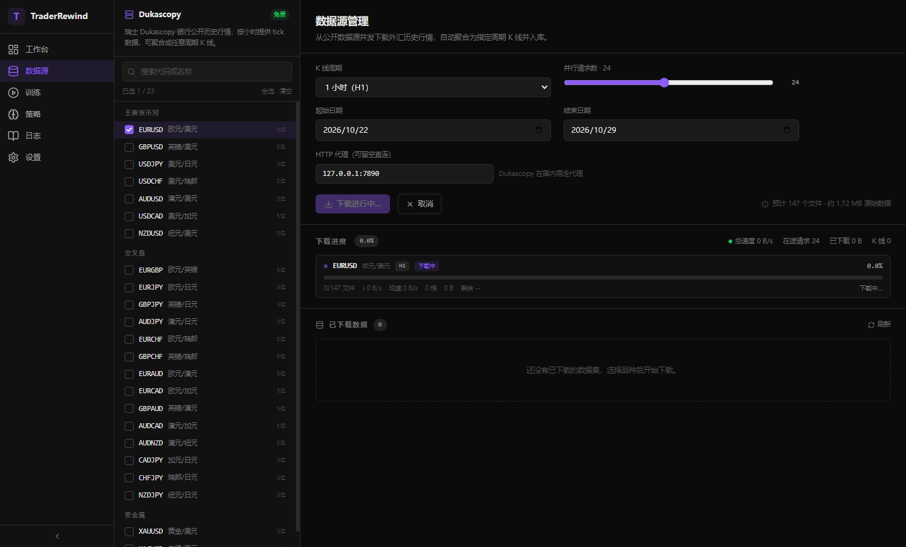
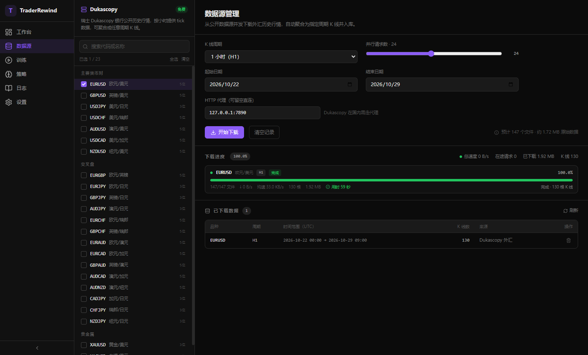
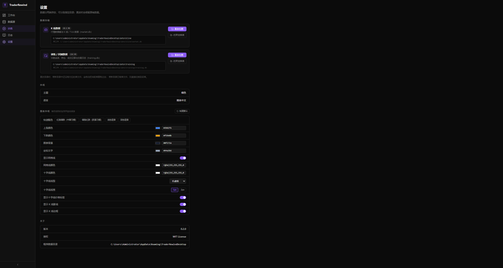

# TraderRewind

历史行情回放与交易训练工具 — 完全本地运行，免费开源。

[](LICENSE)
[](#快速开始)
[](https://www.electronjs.org/)
[](CONTRIBUTING.md)



## 快速开始

```bash
npm install           # 安装依赖（自动 rebuild better-sqlite3 匹配 Electron ABI）
npm run dev           # 启动开发
npm run package:win   # 打包 Windows 安装包
```

> Electron 二进制走国内镜像（见项目 `.npmrc`）。
> 若 `npm install` 报 `@rollup/rollup-win32-x64-msvc` / `@esbuild/win32-x64` 缺失，
> 执行 `npm i -D @rollup/rollup-win32-x64-msvc @esbuild/win32-x64` 补装。

## 已实现功能

### 训练回放（v0.2）


- **K 线逐根回放**：播放 / 暂停、1x–10x 速度、单步进退、进度条跳转
- **顶部工具条**：单行固定高度，周期按钮在最左，其后指标、播控、倍速、报告与进度
- **多周期切换**：图表随时切换 1 分 / 5 分 / 15 分 / 1 小时 / 4 小时 / 日线 / 月线 / 年线，
  切换后自动停在原来的时间位置（由 1 分钟数据实时汇总，各周期口径一致）
- **训练会话**：新建时先选标的、再选回测时间范围（受该标的可用范围约束），
  系统从 1 分钟数据汇总该时段；自动保存进度、余额、当前 K 线与所选周期，可随时继续
- **会话管理**：会话列表支持删除（点垃圾桶两次确认），删除当前会话会自动退出回放；
  列表可一键隐藏（右上角 « 按钮），隐藏后图表占满宽度，右侧 » 可随时恢复，状态本地记忆
- **模拟下单**：买入 / 卖出、手数调节（0.01 步进）、手动平仓
- **画图工具**：图表左侧固定工具栏，支持趋势线 / 水平线 / 垂直线 / 矩形 / 斐波那契回调；
  画完可拖动端点或整体移动，选中后按 Delete 删除，配「清空」按钮；画线随会话保存
- **技术指标**：主图可叠加 MA5 / MA20 / MA60 / EMA12 / EMA26 / BOLL(20,2)，
  副图可选成交量 / MACD / RSI(14)（单选），开关状态随会话保存
- **可拖拽止损止盈**：入场后自动生成入场线（灰）、止损线（红）、止盈线（绿），
  在图上按住 SL / TP 线上下拖动即可调整价格，买多时自动限制在入场价另一侧
- **自动平仓判定**：回放逐根推进时，若该根 K 线触及 SL / TP 立即成交
  （单根 K 线无法还原盘中路径，采用保守规则：先判止损）
- **下单备注**：点「买入 / 卖出」会弹出备注浮窗记录这笔单子的思路，
  可「跳过并下单」直接成交；备注写入 `closed_trades.notes`，复盘时可回看
- **训练报告**：回放走到末尾自动弹出（也可随时点「报告」打开），包含
  总盈亏 / 收益率 / 胜率 / 盈亏比 / 最大回撤、权益曲线、逐笔明细与备注；
  **点击任意一笔交易会跳回 K 线对应时间，并在图上画出该笔的开仓线与关仓线**
- **成交记入训练集**：每笔平仓写入 `closed_trades`（含方向、手数、进出场价、
  盈亏、平仓原因、R 倍数、止损止盈价），刷新或重开会话自动恢复
- **平仓记录面板可调高度**：拖住面板上边缘的把手上下拖动即可放大/缩小，双击恢复默认；
  高度记忆在本地，下次打开保持
- **实时统计**：权益 / 余额、浮动盈亏、交易数、胜率、累计盈亏
- **快捷键**：`空格` 播放/暂停 · `Shift + →` 下一根 · `B` 买入 · `S` 卖出 · `C` 平仓
- **回测不可回退**：不提供「上一根」，进度条也只能向前拖动，避免反悔已发生的行情

### 数据源管理（v0.1）

- **三个可切换的数据源**：左侧面板顶部一键切换，各自有独立的品种目录，
  切换时自动清空已选，避免把外汇代码发给加密接口
- **Dukascopy 免费外汇历史数据**：23 个品种（主要货币对 / 交叉盘 / 贵金属），逐笔 tick 聚合
- **加密市场 K 线**：OKX / Binance 两家公共行情接口（现货，USDT 计价，12 个主流币种），
  直接返回 1 分钟蜡烛，无需本地聚合
- **品种按类别分组折叠**：主要货币对 / 交叉盘 / 贵金属 / 加密市场，点表头折叠展开，
  折叠状态本地记忆；表头右侧可一键勾选或取消整组
- **并发并行下载**：小时级文件独立请求，可配置 1–64 路并发（默认 24），
  使用 keep-alive 连接池避免高并发耗尽本地临时端口；
  过高并发会被数据源限流（HTTP 429），命中过多时自动中止并提示降低并发
  （加密接口限速更严，并发实际会被压到 4~6）
- **实时进度与网速**：进度条、瞬时速度、平均速度、剩余时间、文件计数、K 线根数
- **固定 1 分钟粒度**：只下载 M1，更大周期（5/15/30 分钟、1/4 小时、日线）在绘图时由 1 分钟聚合，
  保证各周期口径一致、可跨周期对照
- **已下载日期自动屏蔽**：选中的品种若已覆盖某段日期，日历中该日期会划线禁用，
  对应的预设按钮也会置灰；整段都已下载时「开始下载」直接禁用并提示
- **时间范围选择**：自研区间选择器
  - **两步选择**：先选开始日期，再选结束日期；顶部两个格子分别显示当前处于哪一步，可点回去改
  - **年月快速跳转**：年份 / 月份下拉框，一键跳到任意年月（2003 年至今）
  - **只选年月也行**：点底部「3 月 1 日」直接以该月 1 号作为当前端点，不必点具体某天
  - 预设「最近 3 / 7 / 30 / 90 天」；选结束时可悬停预览区间；Esc 或点空白关闭
  - 未来日期自动禁用
- **增量入库**：同品种同周期复用数据集，`INSERT OR REPLACE` 合并后重算时间范围
- **代理支持**：HTTP 代理（含 HTTPS CONNECT 隧道），默认 `127.0.0.1:7890`
- **可取消**：任意时刻中断，已完成部分不入库



### 图表外观（设置 → 图表外观）



- **快速配色**：红涨绿跌 / 绿涨红跌 / 浅色背景 / 深色背景 四套预设，一键切换
- **颜色自定义**：上涨色、下跌色、图表背景、坐标文字、网格线、十字线，
  支持取色器与十六进制 / rgba 文本输入，改完**立即生效**
- **十字线**：颜色、线型（实线/点线/虚线/长虚线/稀疏点线）、线宽、价格标签开关，
  以及「吸附到 K 线」开关（默认关闭，十字线跟随鼠标自由移动）
- **K 线细节**：网格线显隐、影线显隐、边框显隐
- 全部设置自动保存到 `settings.json`，并提供「恢复默认」

### 数据存储（可分别指定目录）


数据拆成两个独立的 SQLite 库，目录可在「设置 → 数据存储」中分别指定：

| 类别 | 内容 | 默认位置 |
|---|---|---|
| **K 线数据** | 分组、数据集、K 线、Tick（`market.db`） | `<userData>/data/kline` |
| **训练 / 回测数据** | 会话、持仓、成交、日志、账户（`training.db`） | `<userData>/data/training` |

- 更换目录时，若新目录尚无用同库文件，会自动把当前库复制过去；若已有则直接切换
- 旧版本的单库 `traderrewind.db` 会在首次启动时自动拆分到两个新库，原文件重命名为 `*.migrated`

## 技术栈

| 层 | 技术 |
|---|---|
| 桌面框架 | Electron 33 + electron-vite |
| 主进程 | TypeScript (Node.js) + better-sqlite3 |
| 渲染层 | React 18 + Zustand + Tailwind CSS |
| 图表 | lightweight-charts v5（TradingView） |
| 解压 | lzma（纯 JS，无需原生编译） |

## 项目结构

```
src/
  shared/            共享类型、常量（IPC 通道、品种目录）、日期工具
  main/
    index.ts         主进程入口（窗口、IPC 注册、userData 隔离）
    settings.ts      应用设置（两个数据目录，存 settings.json）
    db/
      connection.ts  双库连接 + 旧库自动拆分迁移
      schema.ts      行情库 / 训练库 两套 schema
      dataset-repo.ts 行情数据落库
    ipc/             db / file / window / data / settings 五组 IPC handler
    services/        dukascopy.ts（tick 下载 / 解压 / 聚合）、candle-api.ts（OKX / Binance K 线分页）
    utils/           http.ts（代理 + keep-alive 连接池）、lzma.ts（解压）
  preload/           contextBridge API
  renderer/src/
    components/
      chart/         ReplayChart.tsx —— K 线回放 + 可拖拽 SL/TP 价格线
      panels/        工作台 / 数据源 / 训练 / 日志 / 设置
    stores/          app-store / download-store / training-store
```

## 数据来源说明

Dukascopy 银行公开历史 tick 数据：

```
http://datafeed.dukascopy.com/datafeed/{SYMBOL}/{YYYY}/{MM0}/{DD}/{HH}h_ticks.bi5
```

- `MM0` 是 **0 索引月份**（`00` = 1 月），写成 1 索引会导致整月错位
- 文件为 LZMA(alone) 压缩；解压后每条 tick 20 字节，**全部大端序**：
  `int32 时间偏移(ms)` + `uint32 ask` + `uint32 bid` + `float32 ask量` + `float32 bid量`
- 价格需除以 `10^digits`（EURUSD 为 5 位，JPY 系为 3 位）
- 使用 **HTTP** 而非 HTTPS：部分网络下 HTTPS 握手会被中断
- 国内直连不稳定，建议配置本地代理

## 文档

- [架构设计](docs/architecture.md)

## 参与贡献

欢迎提 Issue 和 PR。动手之前请先看 [贡献指南](CONTRIBUTING.md)，里面有分支命名、
提交信息规范、代码风格和本地验证要求。

- 报告问题：[新建 Issue](https://github.com/liudosen/TraderRewind/issues/new/choose)
- 安全问题：请不要公开提 Issue，按 [安全策略](SECURITY.md) 私下联系

## 许可证

本项目采用 [Apache License 2.0](LICENSE) 授权。

```
Copyright 2026 liudosen

Licensed under the Apache License, Version 2.0 (the "License");
you may not use this file except in compliance with the License.
You may obtain a copy of the License at

    http://www.apache.org/licenses/LICENSE-2.0
```

### 第三方组件与数据来源

本项目使用了以下开源项目与公开数据接口，在此致谢：

| 名称 | 用途 | 许可证 |
|---|---|---|
| [Electron](https://www.electronjs.org/) | 桌面运行时 | MIT |
| [React](https://react.dev/) | 界面框架 | MIT |
| [lightweight-charts](https://github.com/tradingview/lightweight-charts) | K 线图表（TradingView 出品） | Apache-2.0 |
| [better-sqlite3](https://github.com/WiseLibs/better-sqlite3) | 本地数据库 | MIT |
| [Zustand](https://github.com/pmndrs/zustand) | 状态管理 | MIT |
| [Tailwind CSS](https://tailwindcss.com/) | 样式 | MIT |
| [Dukascopy](https://www.dukascopy.com/) | 外汇历史 tick 数据 | 公开接口 |
| [OKX](https://www.okx.com/) / [Binance](https://www.binance.com/) | 加密市场 K 线 | 公开接口 |

> 行情数据版权归各自数据提供方所有，本项目仅用于个人学习与研究。
> 本项目不构成任何投资建议。
