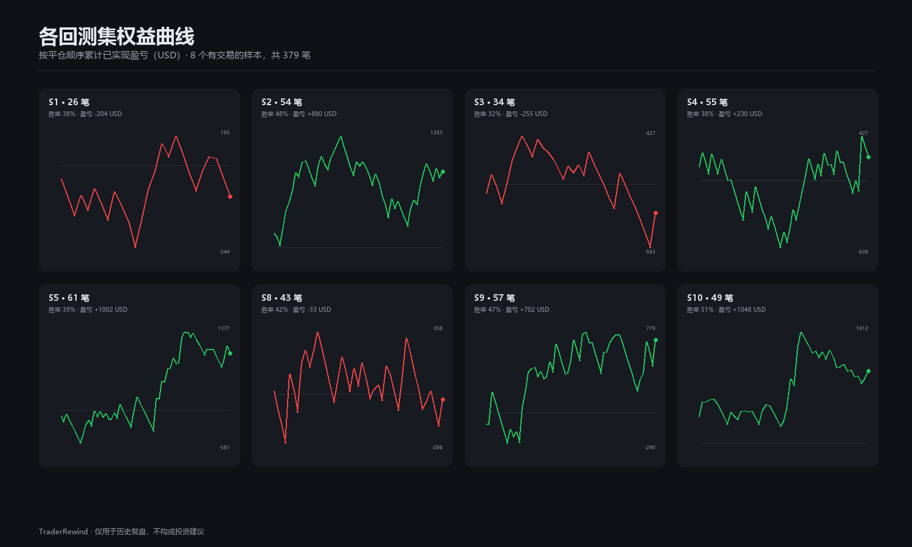
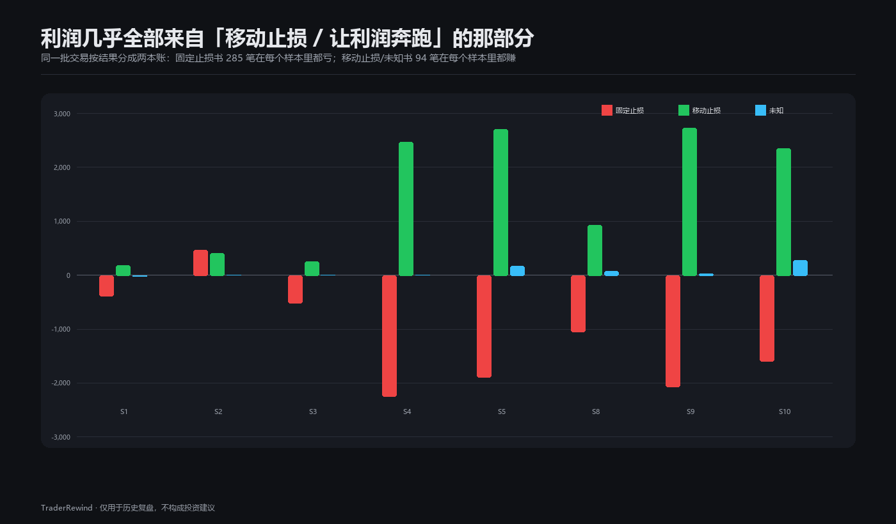
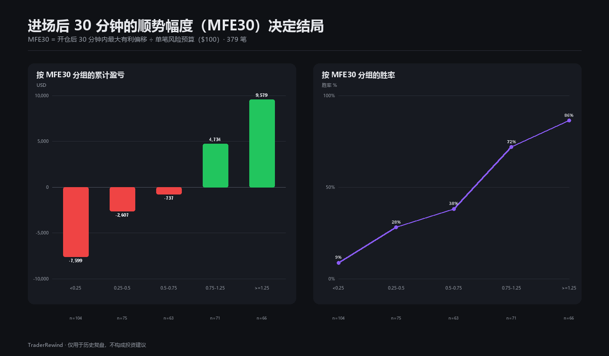
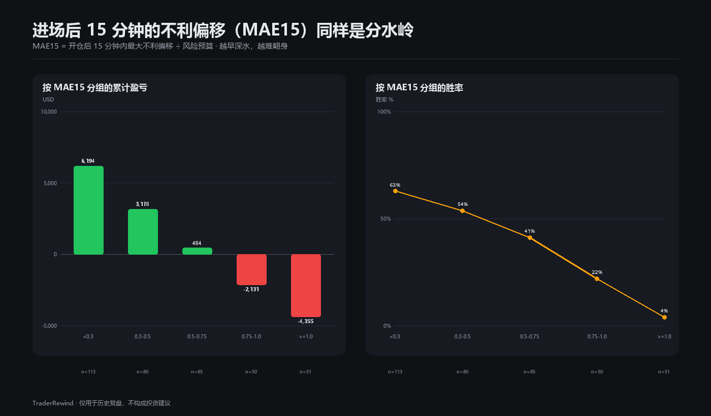
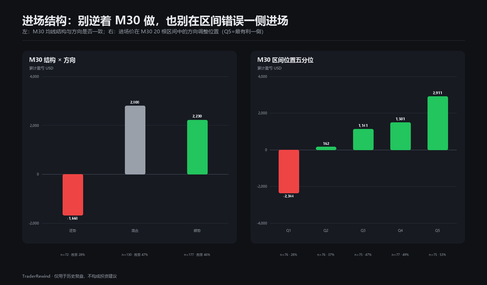
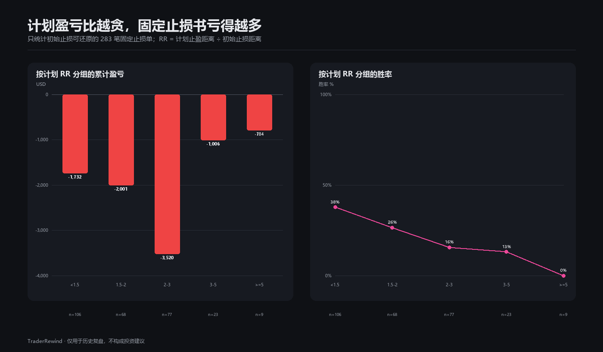
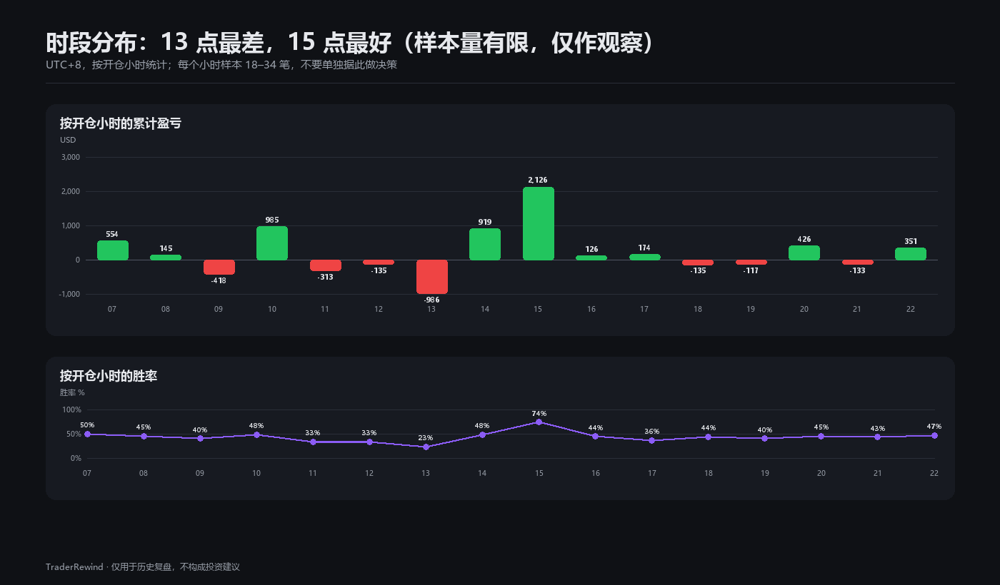

# TraderRewind 交易复盘：379 笔 XAUUSD 训练的亏损共性与盈利共性

生成日期：2026-11-09　|　样本：8 个有交易的训练/回测集，379 笔已平仓订单　|　品种：XAUUSD　|　周期：2026-01 至 2026-10

> **一句话结论**
>
> 这套交易系统的利润不是来自「进场很准」，而是来自「少数进场后立刻走出来的单子，被移动止损/趋势持有放大」。亏损单的共同点非常集中：30 分钟内没有走出 +0.5R、15 分钟内先亏到 -0.75R、逆着 M30 结构、以及把固定止盈设得太远。把入场过滤和「30 分钟不证明自己就退出」做好，比调仓位、换周期更重要。

## 1. 数据与方法

本次分析不是直接读 SQLite，而是走本次新增的应用内 MCP 服务：`list_sessions` → `list_trades` → 对 379 笔订单逐笔 `get_trade_context`（M30/M5/M1 各 120 根进场前 K 线、EMA20/50/200、ATR14、RSI14、20 根区间位置、动量、趋势结构，以及进场后到平仓的 MFE/MAE 与 15/30/60 分钟早期偏移）。行情来自本机 market.db 的 M1 数据，M5/M30 由 M1 聚合，指标只使用进场时点及之前的数据，避免未来函数。

**口径说明**：金额均为净盈亏（已含手续费，来自 closed_trades.profit）；`R` 统一按会话设定的单笔风险预算折算（`profit / risk_per_trade`，默认 $100），而不是应用里那个按「平仓时止损距离」算的 r_multiple。原因见第 5 节：移动过止损的单，r_multiple 会严重失真。

**样本边界**：10 个回测集中 6、7 号没有平仓记录，实际分析 8 个；1、8、10 号交易的是同一个 2026-10 区间（重复挑战），所以「同一段行情」的盈亏差异可以反映执行差异。

| 指标 | 数值 |
|---|---|
| 订单数 | 379 |
| 胜 / 负 | 162 / 217 |
| 胜率 | 42.7% |
| 净盈亏 | +3,370 USD |
| 盈亏比 PF | 1.16 |
| 单笔期望 | +8.89 USD（+0.089R） |
| 平均盈利 / 平均亏损 | 147.60 / -94.66 USD |
| 单样本最大回撤（中位数） | 680 USD |

各回测集的明细如下（S6/S7 无平仓记录，未列出）：

| 样本 | 笔数 | 胜率 | 净盈亏 | 平均 R | 最大回撤 | 持仓中位数 |
|---|---|---|---|---|---|---|
| S1 | 26 | 38.5% | -204 USD | -0.078R | 456 USD | 54m |
| S2 | 54 | 48.1% | +880 USD | +0.163R | 1,036 USD | 28m |
| S3 | 34 | 32.4% | -255 USD | -0.075R | 990 USD | 36m |
| S4 | 55 | 38.2% | +230 USD | +0.042R | 910 USD | 36m |
| S5 | 61 | 39.3% | +1,002 USD | +0.164R | 624 USD | 36m |
| S8 | 43 | 41.9% | -33 USD | -0.008R | 545 USD | 36m |
| S9 | 57 | 47.4% | +702 USD | +0.123R | 565 USD | 32m |
| S10 | 49 | 51.0% | +1,048 USD | +0.214R | 736 USD | 21m |

*图 1：8 个回测集的已实现权益曲线。S1/S3/S8 基本打平或小亏，S5/S10 靠少数大赢家拉开。*

## 2. 先把账拆成两本：固定止损书 vs 移动止损书

同一批交易，按「平仓时止损是否已经移到开仓价的盈利侧」可以拆成两本账。这不是两个可选的策略，而是同一套打法按结果分出来的两组：没有走出来的单子被固定止损打掉，走出来的单子被移动止损/趋势持有放大。它回答的是「利润到底从哪里来」。

| 分组 | 笔数 | 胜率 | 净盈亏 | 平均 R | 持仓中位数 |
|---|---|---|---|---|---|
| 固定止损书（初始止损可还原） | 285 | 25.6% | -9,256 USD | -0.32R | 26 分钟 |
| 移动止损书（trail / 止损已移动） | 77 | 100.0% | +12,069 USD | +1.57R | 55 分钟 |
| 未知（manual 且止损仍在亏损侧） | 17 | 70.6% | +557 USD | +0.33R | 120 分钟 |

固定止损书 285 笔，只赢了 73 笔（25.6%），净盈亏 -9,256 USD；移动止损书 77 笔全部盈利，净盈亏 +12,069 USD。注意这是**按结果分组**，不是两个可选的策略：它说明「没有走出来的那批」是负期望，而利润来自「已经走出来、并且让利润跑下去」的那批，而不是说入场前就能预知哪一批会赢。

*图 2：按回测集拆开看，固定止损书在 7/8 个样本里亏损（S2 小幅盈利），移动止损书在 8/8 个样本里盈利。*

## 3. 亏损的共性

下面每一条都给出样本量、胜率、盈亏和跨样本一致性。样本量小于 30 的结论只作观察，不当作硬规则。

### 3.1 共性一：30 分钟内没有走出来（MFE30 < 0.5R）

MFE30 是开仓后 30 分钟内最大有利偏移，按单笔风险预算折成 R。它不是一个「进场前」指标，而是一个 30 分钟时点就能观察到的「这笔单子有没有立刻证明自己」的信号。

| MFE30 区间 | 笔数 | 胜率 | 净盈亏 | 平均 R |
|---|---|---|---|---|
| <0.25 | 104 | 8.7% | -7,599 USD | -0.73R |
| 0.25-0.5 | 75 | 28.0% | -2,607 USD | -0.35R |
| 0.5-0.75 | 63 | 38.1% | -737 USD | -0.12R |
| 0.75-1.25 | 71 | 71.8% | +4,734 USD | +0.67R |
| >=1.25 | 66 | 86.4% | +9,579 USD | +1.45R |

MFE30 < 0.5R 的 179 笔，只有 30 笔盈利（16.8%），合计 -10,206 USD；MFE30 ≥ 0.75R 的 137 笔，胜率 78.8%，合计 +14,313 USD。分样本看，MFE30 < 0.5R 的胜率在 8 个样本里全部落在 5%–25%，且全部为负；MFE30 ≥ 0.5R 的胜率在 50%–86%，全部为正。

*图 3：MFE30 五个区间的累计盈亏与胜率，几乎是一条单调的分界线。*

> **这条最值得变成规则**
>
> 开仓 30 分钟时，如果 MFE30 还不到 +0.5R，这笔单子大概率不会成为赢家。把它当作「减仓/离场」的检查点，而不是继续扛、加仓或把止损往外推。

### 3.2 共性二：一开始就深水（MAE15 ≥ 0.75R）

MAE15 是开仓后 15 分钟内最大不利偏移。好单子通常很快脱离成本区；一开始就深水的单子，后面很难翻身。

| MAE15 区间 | 笔数 | 胜率 | 净盈亏 | 平均 R |
|---|---|---|---|---|
| <0.3 | 113 | 62.8% | +6,194 USD | +0.55R |
| 0.3-0.5 | 80 | 53.8% | +3,178 USD | +0.40R |
| 0.5-0.75 | 85 | 41.2% | +484 USD | +0.06R |
| 0.75-1.0 | 50 | 22.0% | -2,131 USD | -0.43R |
| >=1.0 | 51 | 3.9% | -4,355 USD | -0.85R |

MAE15 ≥ 0.75R 的 101 笔，只赢了 13 笔（12.9%），合计 -6,486 USD；MAE15 < 0.3R 的 113 笔胜率 62.8%，合计 +6,194 USD。亏损单里有 88 笔（占 217 笔亏损的 40.6%）在 15 分钟内就先亏到 0.75R 以上。

*图 4：MAE15 越大，胜率与盈亏越差；≥1R 的 51 笔只赢了 2 笔。*

### 3.3 共性三：逆着 M30 结构做

把 M30 的 EMA20/EMA50 与收盘价关系定义成 bull / bear / mixed，再和订单方向比较：顺势 = 多头遇 bull、空头遇 bear；逆势 = 多头遇 bear、空头遇 bull；mixed 单独一组。

| M30 结构 × 方向 | 笔数 | 胜率 | 净盈亏 | 平均 R |
|---|---|---|---|---|
| 逆势 | 72 | 27.8% | -1,668 USD | -0.23R |
| 混合 | 130 | 46.9% | +2,808 USD | +0.22R |
| 顺势 | 177 | 45.8% | +2,230 USD | +0.13R |

逆势 72 笔，胜率 27.8%，净亏 -1,668 USD，平均 -0.23R；顺势 + 混合合计 307 笔，净赚 +5,037 USD。把逆势单剔除后，8 个样本里有 7 个改善。注意：顺势（45.8%）和混合（46.9%）的胜率差不多，所以真正要避免的是「明确逆势」，而不是「必须完美顺势」。

*图 5：左为 M30 结构与方向是否一致；右为进场价在 M30 20 根区间中的方向调整位置（Q5 最有利）。*

### 3.4 共性四：在 M30 区间的错误一侧进场

`dir_pos` 把「进场价在最近 20 根 M30 区间中的位置」按方向调整：1 = 多头在区间上沿 / 空头在区间下沿，0 = 相反。Q5 是最有利的一侧，Q1 是「多单买在区间底部、空单卖在区间顶部」的逆向位置。

| M30 区间位置 | 笔数 | 胜率 | 净盈亏 | 平均 R |
|---|---|---|---|---|
| Q1 | 76 | 27.6% | -2,344 USD | -0.31R |
| Q2 | 76 | 36.8% | +162 USD | +0.02R |
| Q3 | 75 | 46.7% | +1,141 USD | +0.15R |
| Q4 | 77 | 49.4% | +1,501 USD | +0.19R |
| Q5 | 75 | 53.3% | +2,911 USD | +0.39R |

Q1 的 76 笔胜率 27.6%，净亏 -2,344 USD；Q5 的 75 笔胜率 53.3%，净赚 +2,911 USD。Q1 在 7/8 个样本里为负，Q5 在 6/8 个样本里为正。另一个容易误读的细节：赢家进场时价格反而更常在 EMA20 的「回踩侧」（多头在 EMA20 下方、空头在上方，方向调整距离 -0.76 ATR），而不是追在 EMA20 外侧。所以更准确的画像是「趋势向上 + 回踩到区间内有利位置再进」，不是「无脑追突破」。

### 3.5 共性五：固定止盈设得太远

这一条只统计初始止损可还原的 283 笔固定止损单。计划 RR = 计划止盈距离 ÷ 初始止损距离。注意：移动止损/手动平仓的单没有可靠的初始止损，不纳入这张表。

| 计划 RR | 笔数 | 胜率 | 净盈亏 | 平均 R |
|---|---|---|---|---|
| <1.5 | 106 | 37.7% | -1,732 USD | -0.16R |
| 1.5-2 | 68 | 26.5% | -2,001 USD | -0.29R |
| 2-3 | 77 | 15.6% | -3,520 USD | -0.46R |
| 3-5 | 23 | 13.0% | -1,006 USD | -0.44R |
| >=5 | 9 | 0.0% | -784 USD | -0.87R |

计划 RR 越高，固定止损书亏得越多：<1.5R 胜率 37.7%，≥5R 的 9 笔全亏。固定止损书里赢家的计划 RR 中位数 1.47R，输家 1.85R（Cliff's δ -0.30，p<0.001）。这不是说「目标越近越好」，而是说：**在一个还没证明自己会走远的单子上，挂一个很远的固定止盈，等于把胜率让给止损。**真正的大利润来自「先走出来、再移动止损跟随」，不是来自一开始就挂在 5R 外。

*图 6：固定止损书的计划 RR 与胜率/盈亏几乎单调负相关。*

### 3.6 次要观察：13 点最差，15 点最好

13:00 开仓的 30 笔胜率 23.3%，合计 -986 USD；15:00 开仓的 27 笔胜率 74.1%，合计 +2,126 USD。13 点在 7/8 个样本里为负（S2 例外），15 点在所有有样本的 7 个样本里为正。但每小时只有 18–34 笔，且没有控制行情 regime，只能作为「观察项」，不要当成硬性时段规则。周五 70 笔胜率 34.3%、净亏 686 USD，但分样本 5 负 3 正，不构成稳定共性，暂不采信。

*图 7：按开仓小时的盈亏与胜率；13 点与 15 点是两端，但样本量有限。*

## 4. 盈利的共性

盈利单不是「运气好」这么简单。把赢家和平行对照放在一起，能看到五个可复用的特征：

- **早期就走出方向**：赢家 MFE30 中位数 1.00R，输家 0.31R；MFE30 ≥ 0.75R 的 137 笔胜率 78.8%，合计 +14,313 USD。
- **回撤浅**：赢家 MAE15 中位数 0.33R，输家 0.65R；MAE15 < 0.3R 的 113 笔胜率 62.8%，合计 +6,194 USD。
- **顺着 M30 结构、在区间有利侧、等回踩**：赢家方向调整区间位置中位数 0.723（输家 0.607），方向调整 RSI 中位数 56.7（输家 53.6，p=0.001），价格更常回踩到 EMA20 的另一侧（p<0.001）。
- **让利润奔跑**：移动止损书 77 笔全部盈利，平均 +156.7 USD/笔，持仓中位数 55 分钟；固定止损书持仓中位数 26 分钟。
- **赢家 MFE 捕获率中位数 88.3%**：不是卖在最高点，而是让止损跟随，把大部分趋势段拿到。输家的 capture 为负（先赚后亏）。

> **盈利的底层结构**
>
> 先用「早期是否走出来」筛掉大部分不会赢的单子，再让少数走出来的单子用移动止损跑完。这套结构里，胜率不需要高（42.7% 就够），但必须让平均盈利（147.6 USD）显著大于平均亏损（94.7 USD），并且不能让「本来 +1R 的单子」变成 -1R。

## 5. 一个必须先修的数据质量问题：r_multiple 对移动止损单失真

应用里的 `closed_trades.r_multiple` 是「盈亏 ÷ 平仓时止损距离」。对没有移动过止损的固定单，这个值可信；但对 trail、部分 tp/manual（止损已经移到盈利侧）的单，分母不再是初始风险，R 会严重失真。本样本 379 笔里，只有 285 笔（75.2%）的初始止损可可靠还原；77 笔是移动止损、17 笔是 manual 且止损仍在亏损侧（无法确认是否初始），合计 94 笔（24.8%）不能直接采信 r_multiple。

举一个具体的例子：一笔 trail 单盈利 +523 USD，按会话 $100 风险预算应该是 +5.23R；但因为它平仓时止损已经移到成本价附近，r_multiple 只显示约 +0.99R。反过来，一些真正亏损的单子 r_multiple 是 -1.01R，看起来「只亏了 1R」，但按 $100 预算可能亏了 1.7R。这会让复盘时「R 分布」和「平均 R」都偏向好看，也会让「大赢家」的贡献被低估。

**建议**：在持仓表/成交表里增加 `initial_sl` 与 `initial_risk_amount`（开仓时写入），平仓时用初始止损算 R；MCP 目前已经同时返回 `rOnRiskTarget`（按会话风险预算）与 `riskBasis`（initial_stop / moved_stop / unknown），分析时请以 `rOnRiskTarget` 为准。

另一个数据缺口：379 笔的 notes、entry_reason、strategy_name、tags 全部为空，mae/mfe 也全部为 NULL。这意味着本次只能从「价格行为」找共性，无法验证「计划内/追单/复仇单/情绪」这类主观标签。如果把这些字段用起来，下一版复盘可以做得更细。

## 6. 可执行规则（按优先级）

### 6.1 入场前：四条过滤

- **不逆势**：M30 的 EMA20/EMA50 结构与方向相反时，不做。样本内逆势 72 笔，胜率 27.8%，净亏 1,668 USD；剔除后 7/8 个样本改善。
- **不在 M30 区间错误一侧**：`dir_pos` 处于最低五分位（多单买在区间底、空单卖在区间顶）时，不做；样本内 76 笔胜率 27.6%，净亏 2,344 USD。要求 `dir_pos ≥ 0.4`，最好 ≥ 0.6。
- **固定止盈优先 1–1.5R，最多不超过 2R**：固定止损书里计划 RR ≥ 2 的 109 笔，胜率约 14%，净亏 5,310 USD。想做趋势，用移动止损，不要用远固定 TP。
- **避开 11:00–13:00**：13:00 单独看 30 笔胜率 23.3%、净亏 986 USD；11–13 整体也不佳。10:00 与 15:00 相对更好，但样本小，先观察。

### 6.2 持仓中：三个检查点

- **30 分钟检查**：MFE30 < +0.5R 且 MAE15 > 0.5R，减仓或离场；不要加仓、不要外推止损。MFE30 < 0.5R 的 179 笔胜率只有 16.8%。
- **+0.75R 之后**：不要急着在 1R 固定止盈；把止损移到成本/ +0.2R，让它跑。移动止损书 77 笔全部盈利，平均 +156.7 USD。
- **+1R 之后**：不允许回到 -1R。最差也要在 +0.2R 附近锁住；样本里“先赚后亏”的单子对心态和账户伤害最大。

### 6.3 仓位：不用改，别用加仓救亏损

初始止损可还原的 285 笔，实际风险均值 97.6 USD，中位数约 98.7 USD，四分位 94.8–102.8 USD；赢家与输家的平均风险几乎一样（97.0 vs 97.8）。**没有证据表明「亏钱是因为仓位太大」**。问题在入场质量，不在仓位。不要用「亏了以后加仓」去救，样本里亏损后手数翻倍以上的 13 笔，胜率只有 23%。

### 6.4 复盘流程：把 MCP 用起来

- 每周拉一次 `list_trades` + 逐笔 `get_trade_context`，给每笔打上四个标签：`align3`、`dir_pos`、`MFE30`、`MAE15`。
- 统计「逆势单」「Q1 单」「固定 RR≥2 单」「13 点单」的数量，目标不是立刻归零，而是逐周下降。
- 把 notes / entry_reason / tags 填起来，下一版才能分析「计划内 vs 追单 vs 复仇单」。

## 7. 样本内规则回放：如果当时按这些规则做

下面不是「未来收益预测」，而是把同一批 379 笔交易按规则做一次事后筛选，看看这些共性如果变成硬规则，在这段历史里会是什么结果。**存在明显的样本内过拟合与多重比较问题，只能作为假设，不能直接实盘。**

| 方案 | 保留笔数 | 胜率 | 净盈亏 | 平均 R | 改善样本 |
|---|---|---|---|---|---|
| 基线（全部） | 379 | 42.7% | +3,370 USD | +0.089R | 0/8 |
| 剔除逆势 | 307 | 46.2% | +5,037 USD | +0.164R | 7/8 |
| 剔除 Q1 | 303 | 46.5% | +5,714 USD | +0.189R | 7/8 |
| 剔除 13 点 | 349 | 44.4% | +4,356 USD | +0.125R | 7/8 |
| 剔除固定 RR≥2 | 270 | 54.4% | +8,680 USD | +0.322R | 7/8 |
| 四条合并 | 184 | 62.5% | +8,962 USD | +0.487R | 8/8 |

四条合并后保留 184 笔（48.5%），胜率 62.5%，净盈亏 +8,962 USD，平均 +0.487R，8/8 个样本都改善。代价是丢掉一半交易机会；如果这些规则真的有效，应该先用小仓位、固定规则、至少 50–100 笔前向验证，而不是直接放大仓位。

另外两个「管理动作」的样本内回放：① 30 分钟时 MFE30 < 0.25R 就离场，总盈亏从 +3,370 提高到 +4,011（+642，34 笔被提前切掉）；② 只把固定止盈改成 0.75R，固定止损书从 -9,256 改善到 -6,544（+2,712），但仍然亏损。这说明**出场优化只能减亏，不能把负期望的入场变成正期望**；核心还是入场过滤。

## 8. 局限与下一步

- 样本只有 379 笔、8 个回测集、一个品种（XAUUSD）、一个年度区间；结论可能只适用于这段行情的波动结构。
- 1/8/10 是同一段 2026-10 行情的重复挑战，不能当作三个独立市场样本；不过它们的盈亏差异（-204 / -33 / +1,048）反而说明执行差异很重要。
- MFE/MAE 由 M1 K 线计算；同一分钟内先止损还是先止盈无法还原，本文按「先止损」保守处理。
- 移动止损/手动平仓的单，初始止损未知；本文用会话风险预算 $100 折算 MFE/MAE，并在固定止损子集上做对照。
- 没有 notes / tags / entry_reason，无法区分「计划内亏损」和「违纪亏损」；这是下一步最值得补的数据。
- 所有「共性」都是描述性统计，不是因果；样本内规则回放有过拟合风险，需要前向验证。

## 附录：复现方式与文件

应用内 MCP 端点：`http://127.0.0.1:47821/mcp`（设置 → MCP 可改端口/关闭）。工具：`list_sessions`、`list_trades`、`get_trade`、`get_trade_context`、`get_candles`、`analyze_trades`。本次数据由 `analysis/collect_via_mcp.py` 通过 MCP 拉取，`analysis/build_dataset.py` 生成特征表，`analysis/analyze.py` / `feature_compare.py` / `whatif*.py` 产出统计，`analysis/charts.py` 产图。

附件：`analysis/output/report_facts.json`（全部引用数字）、`analysis/data/features.csv`（379 笔逐笔特征）、`reports/figures/`（7 张图）、`analysis/output/whatif_*.csv`（规则回放明细）。
